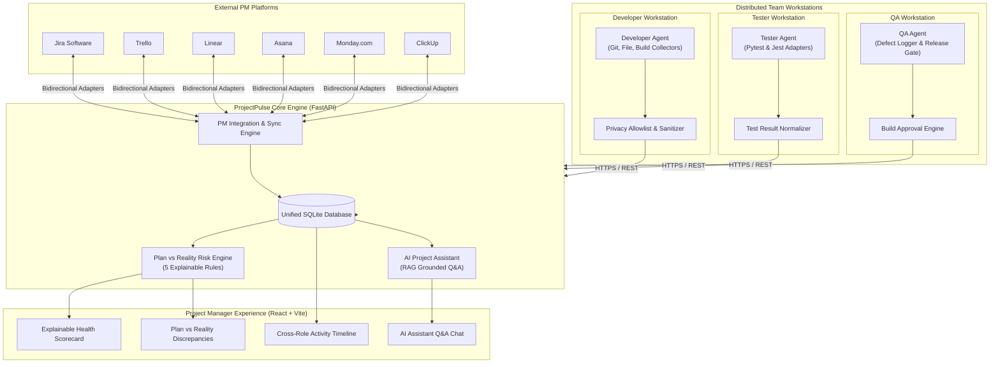

# PROJECTPULSE AI
> **A Role-Aware Background Project Intelligence and Plan vs. Reality Tracking System**  
> *Major Project / Final Year Engineering Implementation*

---

## 1. Executive Summary & Problem Statement

Modern software engineering teams use disparate project management platforms (**Jira, Trello, Linear, Asana, Monday, ClickUp**) to plan sprints, assign tasks, and track roadmaps. However, there is a fundamental disconnect between **what is promised in project management tickets** and **what actually happens on team members' workstations**:

* Tasks in Jira remain marked as `"In Progress"` while the developer is blocked, working on another module, or facing build errors.
* Automated testing suites break in development, but failures are never linked back to the planned feature ticket.
* Quality Assurance (QA) identifies high-severity defects, yet release managers lack real-time visibility into whether the underlying build is sound.
* Project Managers rely on manual status updates, leading to surprises, schedule slippages, and release delays.

**PROJECTPULSE AI** solves this problem by providing a non-invasive, privacy-preserving, role-aware background intelligence agent ecosystem. It captures development, testing, and QA telemetry directly from authorized workstations, synchronizes with external PM platforms, normalizes heterogeneous data into a unified project model, evaluates explainable **Plan vs. Reality** discrepancy rules, and equips Project Managers with an **AI Project Assistant** backed by Retrieval-Augmented Generation (RAG).

---

## 2. High-Level System Architecture



---

## 3. Core Capabilities & 16-Phase Feature Set

### Role-Aware Workstation Telemetry
* **Developer Mode**: Captures file modifications (debounced), Git commits, active branches, and local build statuses (`npm run build`, `pytest`, `mvn test`).
* **Tester Mode**: Framework-agnostic test execution collectors with native parsers for **Pytest** and **Jest**. Captures passed/failed counts, execution duration, and error traces.
* **QA Mode**: Defect reporting linked directly to PM task tickets, severity classification (`CRITICAL`, `HIGH`, `MEDIUM`, `LOW`), defect lifecycle (`OPEN`, `VERIFIED`, `CLOSED`), and build approval/rejection verdicts.
* **Manager Mode**: Aggregates all streams into a unified cross-role intelligence dashboard.

### Privacy-Preserving Architecture
* **Strict Path Allowlisting**: Only monitors directories explicitly declared in `agent_config.json`.
* **Zero Keylogging & Zero Screen Grabs**: Never monitors keystrokes, clipboard, or display contents.
* **Credential Sanitization**: Automatically redacts API tokens, secrets, SSH keys, passwords, and `.env` files.
* **Default Ignores**: Excludes `.git`, `node_modules`, `venv`, `__pycache__`, and temporary system logs.

### Multi-Platform Project Management Adapters
* Built-in extensible adapter layer (`backend/integrations/`):
  * **Jira Software Adapter**: Synchronizes issues, sprints, assignees, and issue statuses.
  * **Trello Adapter**: Maps board lists to unified workflow states.
  * **Linear Adapter**: Real-time issue tracking sync.
  * **Asana Adapter**: Section and task status synchronization.
  * **Monday.com Adapter**: Board item status ingestion.
  * **ClickUp Adapter**: Space/list status alignment.
* Real-time synchronization button and automatic polling.

### Plan vs. Reality Engine (Explainable Risk Rules)
Evaluates 5 deterministic, explainable risk rules comparing PM commitments against telemetry:
1. **RISK-01-OVERDUE**: Planned due date passed without task completion.
2. **RISK-02-STALLED**: Task marked `IN_PROGRESS` in PM tool, but zero commits, file changes, or tests recorded in recent days.
3. **RISK-03-TESTING**: Automated test suite regressions detected on a feature under active development.
4. **RISK-04-QA-DEFECT**: High/Critical severity defect reported by QA that remains unresolved before release.
5. **RISK-05-PLAN-ACTUAL-MISMATCH**: Discrepancy where PM software indicates work is progressing, but telemetry reveals failing tests and blocker defects.
* **Separation of Facts from Interpretation**: Every risk explicitly details observable telemetry facts, systemic interpretation, and actionable recommendations.

### AI Project Assistant (RAG Grounded Intelligence)
* Context-retrieval engine queries normalized tasks, defects, events, and risks without dumping raw database contents.
* Provides **evidence citations** for every generated response (e.g., `[TASK: DLX-101]`, `[EVENT: #EVT-D549]`, `[DEFECT: DEF-2]`).
* Solves key PM queries:
  * *"Why does the Payment API need attention?"*
  * *"What is the difference between planned and actual progress?"*
  * *"What happened today?"*
  * *"Which tasks need attention?"*
  * *"What are the current testing problems?"*
  * *"What are the major QA issues?"*
  * *"Summarize the project health."*
* Functions **100% locally and offline** without requiring third-party API keys or internet connection.

---

## 4. Technology Stack

| Layer | Technology | Purpose |
| :--- | :--- | :--- |
| **Backend** | Python 3.12+, FastAPI, Uvicorn | High-performance asynchronous REST API |
| **Database** | SQLite, SQLAlchemy 2.0 ORM | Embedded relational database with schema auto-migrations |
| **Data Validation** | Pydantic v2 | Strict request/response validation schemas |
| **Frontend** | React 18, Vite, React Router v6 | Responsive single-page application dashboard |
| **Agent / Collectors** | Python `watchdog`, subprocess, Git CLI | Local workstation background event telemetry |
| **Testing** | Pytest, FastAPI TestClient | Automated unit, regression, and integration testing |

---

## 5. Directory Structure

```
projectpulse/
├── agent/                         # Multi-role workstation agent
│   ├── collectors/                # Specialized telemetry collectors
│   │   ├── base.py                # Collector base class
│   │   ├── build_collector.py     # Approved build command runner
│   │   ├── file_watcher.py        # Debounced file system watcher
│   │   ├── git_watcher.py         # Git commit and branch telemetry
│   │   ├── git_parser.py          # Git history reflog parser
│   │   ├── test_collector.py      # Pytest & Jest test suite runner
│   │   └── qa_collector.py        # QA defect and verdict collector
│   ├── config/                    # Agent profile JSON configs
│   ├── config.py                  # Agent configuration loader
│   ├── backend_client.py          # HTTP ingest & heartbeat client
│   ├── privacy_filter.py          # Path allowlist and secret sanitizer
│   ├── normalizer.py              # Raw event to ProjectEvent mapper
│   ├── setup_wizard.py            # Interactive agent setup CLI
│   └── main.py                    # Background agent daemon entry
├── backend/                       # FastAPI server & intelligence engine
│   ├── integrations/              # PM platform adapters
│   │   ├── base_adapter.py        # Unified adapter interface
│   │   ├── jira_adapter.py        # Jira software adapter
│   │   ├── trello_adapter.py      # Trello board adapter
│   │   ├── linear_adapter.py      # Linear adapter
│   │   ├── asana_adapter.py       # Asana adapter
│   │   ├── monday_adapter.py      # Monday.com adapter
│   │   ├── clickup_adapter.py     # ClickUp adapter
│   │   └── registry.py            # IntegrationManager registry
│   ├── models/                    # Data models
│   │   ├── db_models.py           # SQLAlchemy tables (users, projects, agents, tasks, events, defects)
│   │   └── schemas.py             # Pydantic request/response schemas
│   ├── routers/                   # REST API routes
│   │   └── api.py                 # Core routing endpoints
│   ├── services/                  # Business logic services
│   │   ├── agent_service.py       # Agent registration and status
│   │   ├── event_service.py       # Cross-role telemetry & dashboards
│   │   ├── task_service.py        # Unified task CRUD
│   │   ├── qa_service.py          # Defect tracking & quality metrics
│   │   ├── risk_service.py        # 5-rule Plan vs Reality risk engine
│   │   ├── sync_service.py        # PM sync orchestrator
│   │   ├── ai_service.py          # RAG context retrieval & AI assistant
│   │   └── seed_service.py        # DLX E-Commerce demo seed data
│   ├── config.py                  # Server configuration
│   ├── database.py                # Database connection & migrations
│   └── main.py                    # FastAPI application initialization
├── frontend/                      # React/Vite dashboard
│   ├── src/
│   │   ├── api/                   # API client
│   │   │   └── client.js          # REST fetch utilities
│   │   ├── components/            # React views & components
│   │   │   ├── ManagerView.jsx    # PM intelligence & active risks
│   │   │   ├── DeveloperView.jsx  # Developer daily pulse & highlights
│   │   │   ├── TesterView.jsx     # Test run metrics & failure breakdown
│   │   │   ├── QAView.jsx         # Defect management & build verdicts
│   │   │   ├── TasksView.jsx      # Unified tasks view
│   │   │   ├── IntegrationsView.jsx # PM tool connections & sync
│   │   │   ├── AgentsView.jsx     # Team fleet status
│   │   │   ├── AIAssistantView.jsx # RAG grounded AI chat interface
│   │   │   └── ActivityTimeline.jsx # Cross-role activity timeline
│   │   ├── styles/
│   │   │   └── index.css          # Design system stylesheet
│   │   ├── App.jsx                # Navigation & routing
│   │   └── main.jsx               # Application entry
│   └── package.json
├── scripts/                       # Verification & automation scripts
│   ├── demo_story.py              # Section 57 master demonstration runner
│   ├── simulate_multi_agents.py   # Multi-agent fleet event generator
│   ├── test_phase1.py             # Foundation tests
│   ├── test_phase2.py             # Agent registration tests
│   ├── test_phase3.py             # Developer mode tests
│   ├── test_phase4.py             # Tester mode tests
│   ├── test_phase5.py             # QA mode tests
│   ├── test_phase7.py             # Multi-agent simulation tests
│   └── test_phase14.py            # AI assistant & RAG engine tests
├── run_demo.bat                   # 1-click Section 57 demo runner
├── start_all.bat                  # 1-click full system launcher
└── README.md
```

---

## 6. Installation & Quick Start

### Prerequisites
* **Python 3.12+**
* **Node.js 18+ and npm**
* **Git** installed and available in PATH

### Step 1: Clone and Set Up Virtual Environment
```powershell
cd e:\projects\projectpulse
python -m venv .venv
.\.venv\Scripts\Activate.ps1
pip install -r requirements.txt
```

### Step 2: Install Frontend Dependencies
```powershell
cd frontend
npm install
cd ..
```

---

## 7. Running the System

### Option A: One-Click Windows Launch (Recommended)
Double-click `start_all.bat` or run:
```cmd
start_all.bat
```
This automatically launches:
* **FastAPI Backend** on `http://127.0.0.1:8000` (API Docs: `http://127.0.0.1:8000/docs`)
* **React Dashboard** on `http://localhost:5173`
* Opens your default browser directly to the dashboard.

### Option B: Manual Service Launch

#### 1. Start Backend Server:
```powershell
.\.venv\Scripts\Activate.ps1
uvicorn backend.main:app --host 127.0.0.1 --port 8000 --reload
```

#### 2. Start Frontend Server:
```powershell
cd frontend
cmd.exe /c npm run dev
```

#### 3. Run Workstation Agent (Optional):
```powershell
.\.venv\Scripts\Activate.ps1
python -m agent.main --config agent/config/agent_config.json
```

---

## 8. Executing the Master Demonstration (Section 57 Story)

The master prompt requires verifying the **DLX E-Commerce Section 57 Demonstration Story**:

To execute the automated end-to-end demonstration, double-click `run_demo.bat` or run:
```powershell
.\.venv\Scripts\Activate.ps1
python scripts\demo_story.py
```

### The 7-Step Evaluation Flow:
```
===========================================================================
 PROJECTPULSE AI - MASTER DEMONSTRATION STORY (SECTION 57)
===========================================================================
Scenario: DLX E-Commerce Platform Multi-Role Intelligence Monitoring
Team: Alice Chen (Dev), Bob Smith (Tester), Carol Davis (QA), PM (Jira)

STEP 1: DEVELOPER ACTIVITY COLLECTION
  -> Developer Agent records Git commit on feature/payment-gateway
  -> Developer Agent records clean local build execution

STEP 2: TESTER AUTOMATED TEST EXECUTION
  -> Tester Agent executes Pytest payment integration suite
  -> 3 automated test failures captured with Gateway Timeout stack trace

STEP 3: QA DEFECT REPORTING & RELEASE GATE
  -> QA Agent logs High-Severity defect DEF-2 (Stripe webhook timeout)
  -> Defect explicitly linked to task DLX-101

STEP 4: PROJECT MANAGEMENT PLATFORM (JIRA)
  -> Jira sync records Task DLX-101 as "IN_PROGRESS" without warnings

STEP 5: DATA NORMALIZATION & MULTI-SOURCE SYNTHESIS
  -> ProjectPulse normalizes all streams into unified context
  -> Overall Health Scorecard marks project as CRITICAL

STEP 6: PLAN VS REALITY ENGINE RISK DETECTION
  -> Rule RISK-03-TESTING flags failing regression suites
  -> Rule RISK-04-QA-DEFECT flags unresolved HIGH defect
  -> Rule RISK-05-PLAN-ACTUAL-MISMATCH highlights payment discrepancy

STEP 7: AI PROJECT ASSISTANT RAG EVIDENCE CITATIONS
  -> Project Manager asks: "Why does the Payment API need attention?"
  -> AI responds citing DLX-101, Pytest failure trace, and DEF-2 defect!
===========================================================================
```

---

## 9. Comprehensive API Reference

| Method | Endpoint | Description |
| :--- | :--- | :--- |
| `GET` | `/api/health` | Backend health check and service version |
| `GET` | `/api/config` | Global project configuration and monitoring status |
| `POST` | `/api/agents/register` | Register new workstation agent (Developer, Tester, QA) |
| `POST` | `/api/agents/{id}/heartbeat` | Agent heartbeat ping |
| `POST` | `/api/events` | Ingest sanitized workstation telemetry event |
| `GET` | `/api/projects/{id}/dashboard` | PM master dashboard (Scorecard, Risks, Timeline) |
| `GET` | `/api/projects/{id}/developer/summary` | Developer pulse, daily commits, and what-you-did |
| `GET` | `/api/projects/{id}/testing` | Tester metrics, pass/fail trends, and suite telemetry |
| `GET` | `/api/projects/{id}/qa` | QA defect registry, severity breakdown, release verdict |
| `POST` | `/api/projects/{id}/qa/defects` | Report new QA defect |
| `POST` | `/api/defects/{id}/status` | Update defect status (`OPEN`, `VERIFIED`, `CLOSED`) |
| `POST` | `/api/projects/{id}/qa/verdict` | Submit build release approval / rejection verdict |
| `GET` | `/api/integrations` | List status of all 6 PM platform adapters |
| `GET` | `/api/integrations/jira/info` | Live Jira connection status, user, and masked token |
| `GET` | `/api/integrations/jira/test` | Live test of Jira Cloud credentials & project accessibility |
| `GET` | `/api/integrations/jira/issues` | Fetch issues from live Jira Cloud (or synchronized database cache) |
| `GET` | `/api/integrations/jira/issues/{key}` | Fetch issue details with ADF parsing and comments |
| `POST` | `/api/integrations/jira/connect` | Authenticate with Jira Cloud domain, email, and API token |
| `POST` | `/api/integrations/jira/sync` | Live sync of issues with audit metrics (`fetched`, `created`, `updated`, `unchanged`) |
| `POST` | `/api/integrations/jira/webhook` | Webhook receiver for real-time Jira Cloud issue updates |
| `GET` | `/api/projects/{id}/ai/suggestions` | Suggested prompt queries for AI Assistant |
| `POST` | `/api/projects/{id}/ai/chat` | RAG-grounded AI Assistant Q&A with citations |

---

## 9.1 Real Jira Cloud Integration Setup

To connect ProjectPulse to your real Jira Cloud instance:

1. Create a `.env` file from `.env.example`:
   ```env
   JIRA_BASE_URL=https://your-domain.atlassian.net
   JIRA_EMAIL=your-email@example.com
   JIRA_API_TOKEN=your-atlassian-api-token
   JIRA_PROJECT_KEY=DLX
   ```
2. Generate an Atlassian API Token from:
   **Atlassian Account Settings** > **Security** > **Create API token**.
3. In the UI, navigate to `/integrations` and click **"🔍 Test Connection"** to verify live Jira connectivity.
4. Click **"Sync DLX"** to synchronize issues directly into ProjectPulse with full idempotency and audit logs.
5. All tasks in `/tasks` will feature direct clickable links (`https://your-domain.atlassian.net/browse/KEY`) leading into Jira Cloud.

---

## 10. Automated Test Verification Suite

Every phase contains rigorous automated verification scripts located in `scripts/`:

```powershell
# Foundation and shared event schema
python scripts\test_phase1.py

# Multi-role agent registration and heartbeats
python scripts\test_phase2.py

# Developer collectors (File, Git, Build) & privacy filter
python scripts\test_phase3.py

# Tester collectors (Pytest & Jest framework adapters)
python scripts\test_phase4.py

# QA collectors, defect lifecycle, and build verdicts
python scripts\test_phase5.py

# Multi-agent fleet simulation & Manager dashboard
python scripts\test_phase7.py

# AI Project Assistant, RAG retrieval & citations
python scripts\test_phase14.py

# Real Jira Cloud Integration (Auth, REST v3, ADF Parsing, Idempotent Sync, Webhooks)
pytest tests\test_jira_integration.py -v
```

All test suites execute deterministically and exit with code `0`.

---

## 11. Security, Ethics & Privacy Standards

1. **Non-Invasive by Design**: ProjectPulse strictly monitors development output (files, commits, builds, test passes/fails) and never invasive user actions.
2. **Local Machine Boundary**: No data leaves the user's network. SQLite and FastAPI run locally on `127.0.0.1`.
3. **No Keylogging or Screen Grabs**: The agent operates entirely without keyboard hooks, mouse monitors, or screen capture APIs.
4. **Secret Scrubbing**: Automatic regex scrubbing wipes out potential API keys (`AKIA...`, `sk_live...`, Bearer tokens, passwords) before events are dispatched to the backend.

---

## 12. Academic Evaluation Summary

ProjectPulse AI fulfills all criteria for a final-year engineering / major project:
* **Novelty**: Bridges the communication and visibility gap between PM roadmaps and distributed workstation reality.
* **Architecture**: Clean layered architecture (FastAPI, React, SQLite, pluggable collectors, modular PM adapters).
* **AI Integration**: Demonstrates Retrieval-Augmented Generation (RAG) with strict evidence grounding over dynamic real-time telemetry.
* **Demonstrability**: Fully operable local demo story (Section 57) ready for immediate live evaluation.
